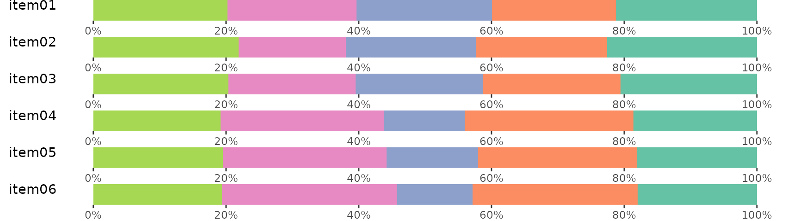

# Examples

``` r

library(lblvm)
```

## Bounded-continuous Response Model

``` r

head(continuous_data)
```

    ##             v1        v2         v3         v4         v5
    ## [1,] 0.4379577 0.5543402 0.42007325 0.05193340 0.13475120
    ## [2,] 0.6151438 0.5512465 0.33395424 0.65493079 0.59117841
    ## [3,] 0.4553825 0.1865655 0.15766805 0.07710646 0.02070261
    ## [4,] 0.6987440 0.8999506 0.95195628 0.79046578 0.92697084
    ## [5,] 0.5844715 0.5854973 0.64820894 0.52470472 0.68358525
    ## [6,] 0.4195393 0.5064547 0.09878155 0.12388480 0.14388044

``` r

fit_continuous <- efa_cont(data = continuous_data, dimension = 1)
```

``` r

formula_string <- "
f1 ~ v1 + v2 + v3 + v4 + v5 # factor structure

v1.nu == v2.nu # equal values

v1.f1 <- 1 # fix parameter
"

fit_continuous <- cfa_cont(formula = formula_string, data = continuous_data)
```

#### Estimated Parameters

``` r

fit_continuous$par_est
```

    ##           f1            c       nu
    ## v1 1.0000000  0.002217919 6.428686
    ## v2 0.8964988 -0.001137983 6.428686
    ## v3 0.9017181  0.002756791 6.337895
    ## v4 0.9747930  0.061115761 7.506682
    ## v5 0.8975229 -0.001076288 6.600591

## Discretized Response Model

``` r

head(categorical_data)
```

    ##      v1 v2 v3 v4 v5 v6
    ## [1,]  3  2  4  3  4  3
    ## [2,]  4  2  5  4  2  3
    ## [3,]  2  2  1  3  2  2
    ## [4,]  3  4  5  4  4  5
    ## [5,]  3  3  3  1  3  4
    ## [6,]  2  2  2  2  4  1

``` r

t_sd <- t_prior_sd(200,5)

fit_categorical <- efa_drm(data = categorical_data, dimension = 1, t_prior = t_sd)
```

``` r

formula_string <- "
f1 ~ v1 + v2 + v3 + v4 + v5 + v6 # factor structure

v1.nu == v2.nu # equal values

v1.f1 <- 0.7 # fix parameter
"

fit_categorical <- cfa_drm(formula = formula_string, data = categorical_data)
```

#### Estimated Parameters

``` r

fit_categorical$par_est
```

    ## [[1]]
    ##           f1           c
    ## v1 0.7000000  0.03268369
    ## v2 0.6124673 -0.05295517
    ## v3 0.8107827  0.01414367
    ## v4 0.6427451  0.03352238
    ## v5 0.7171871  0.04254146
    ## v6 0.6809082  0.05591179
    ## 
    ## [[2]]
    ##          nu          t1           t2          t3          t4
    ## v1 7.905651 -0.04083870  0.006740999 -0.08019118  0.04723286
    ## v2 7.905651 -0.29912536 -0.111784075 -0.10036772  0.03149359
    ## v3 7.973343 -0.06138573 -0.058972869  0.01844436  0.01080422
    ## v4 7.192069  0.25131759 -0.453184411  0.28162322 -0.03170281
    ## v5 6.761288  0.23526896 -0.346481851  0.20364775 -0.07440306
    ## v6 7.711653  0.31170633 -0.538808670  0.25059122 -0.07338741

#### Estimated Category Thresholds

Items 4–6 have been designed to have narrow middle categories.

``` r

plot(fit_categorical)
```


